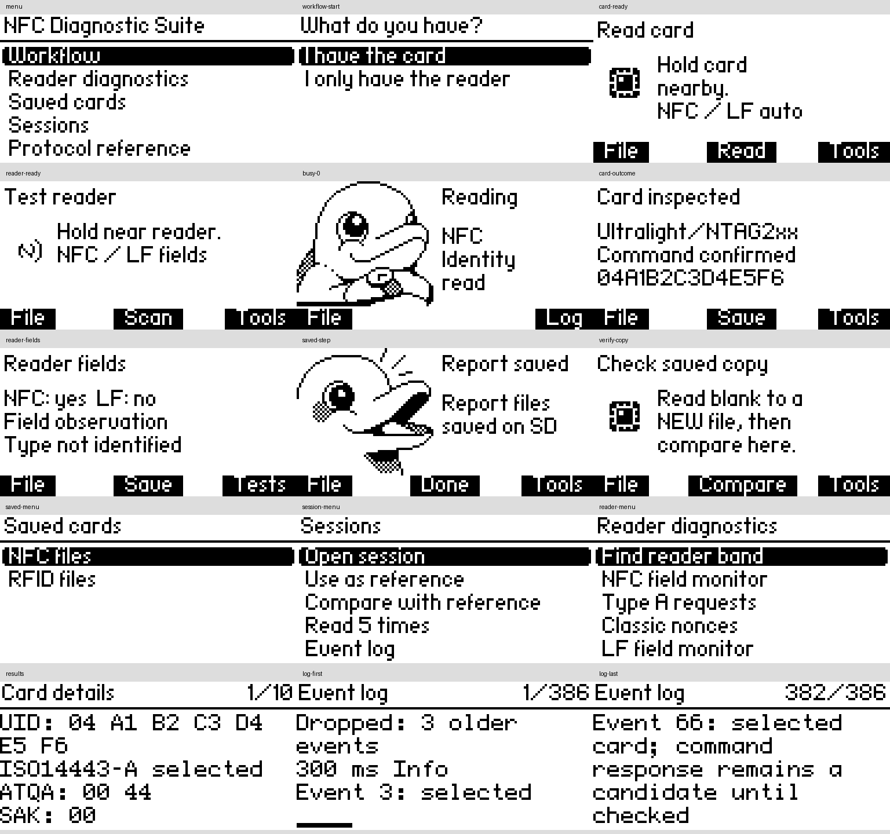

# NFC Diagnostic Suite

Native 13.56 MHz NFC and 125 kHz RFID diagnostics for Flipper Zero with Momentum firmware. Inspect cards, observe readers, compare saved data and follow evidence-based actions on systems you own or are authorized to test. No expansion module is required.

## Install and use

Download `nfc_diagnostic_suite.fap` from the [latest release](https://github.com/CatlordReal/nfc-diagnostic-suite/releases/latest), then copy it to `SD/apps/NFC/` with qFlipper or an SD card reader. The optional installer ZIP contains the same FAP, README, license, icon and build record.

Open **NFC Diagnostic Suite → Workflow**, then choose **I have the card** or **I only have the reader**. Card identification tries NFC, then native LF decoding when no NFC identity appears. Reader diagnostics observe supported NFC/LF activity without inventing card data.

The workflow shows one relevant step at a time:

- **File** selects a saved source or verification target.
- **Tools** shows actions supported by current evidence and installed tools.
- **Log** opens live events during an active operation.
- **Save** writes the final `.nds`, JSON and CSV reports to `SD/apps_data/nfc_diagnostic_suite/`.

After a write handoff, read the copy into a **new** file and compare it with the source. After a recovery handoff, re-read the original and save the new result. Returning from another tool never marks its operation successful.

**Saved cards** opens validated `.nfc` and `.rfid` files. **Sessions** opens reports, retains or compares a reference and repeats five reads using the last detected card band. **Up/Down** scrolls; **Back** cancels or returns.

Results distinguish direct confirmation, candidates and saved historical evidence. Saved-data equality does not prove physical identity or reader acceptance. Reports contain observed identifiers.

## Build from source

```sh
./scripts/setup-momentum.sh
./scripts/test.sh
./scripts/build.sh
python3 scripts/package.py
```

Output: `dist/nfc_diagnostic_suite.fap` and optional five-file installer ZIP. Target: Momentum `mntm-012`, commit `e1784e7418d8b074e971983ceb6fef0f37e52ae4`, API **87.1**. `dist/BUILD.txt` records the built revision and checksum.

Host builds and renderer captures do not prove physical RF behavior, cancellation timing, SD power-loss handling or reader acceptance. See [engineering details and proof limits](docs/ENGINEERING.md).



Host captures of the actual C renderer with simulated states; not hardware screenshots.
